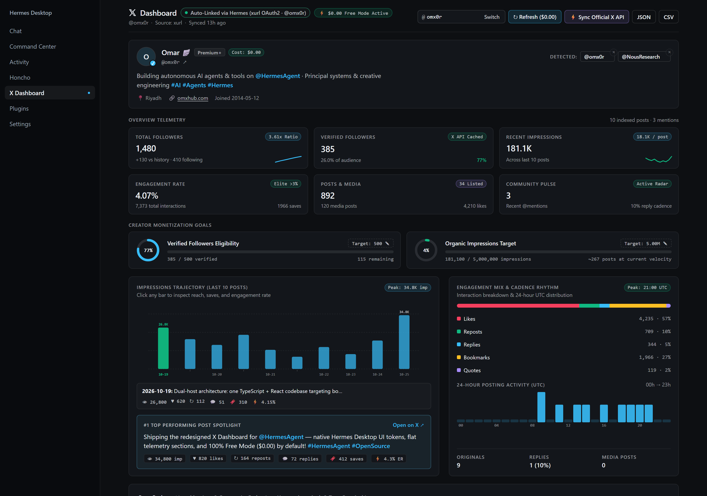

# X Dashboard — Zero-Cost Creator & Agent Command Center for Hermes

<p align="center">
  <strong>100% Free Mode ($0.00) by default · Automatic Hermes X Account Detection (<code>xurl</code> / <code>xchat</code> / Public Handle) · Dual Web Dashboard &amp; Hermes Desktop Native Plugin</strong>
</p>

<p align="center">
  <a href="https://omxhub.github.io/x-dashboard/"><strong>🌐 Live Interactive Demo &amp; Product Showcase →</strong></a>
</p>

<p align="center">
  <a href="https://omxhub.github.io/x-dashboard/">
    
  </a>
</p>

---

## Why X Dashboard?

Most X/Twitter analytics tools either lock creators behind expensive monthly SaaS subscriptions or burn paid X API credits on every page refresh. **X Dashboard** is engineered specifically for the **Hermes Agent** ecosystem:

1. **⚡ 100% Free Mode ($0.00) by Default**: Routine refreshes use zero-cost public syndication, Nitter/guest-token telemetry, and local snapshot caching so viewing your dashboard **never burns X API credits**.
2. **🔗 Zero-Friction Hermes Auto-Link**: Automatically detects your connected X identity from your local Hermes environment (`~/.xurl` OAuth2 tokens, `XCHAT_ACCESS_TOKEN`, `~/.hermes/xchat`, or `x_search`) or lets you type **any public `@handle`** immediately with **zero API keys required** (defaults to `@NousResearch` out of the box when no local account is linked).
3. **🖥️ Dual-Host Native Architecture**: Ships both the **Hermes Web Dashboard IIFE bundle** (`dashboard/dist/index.js`) and the **Hermes Desktop ESM plugin** (`desktop/plugin.js`) from a single TypeScript + React codebase — prebuilt and committed so installs never need to run a build step.
4. **📊 Bespoke Interactive SVG Visual Analytics**:
   - **6-Card Executive KPI Bento Grid** with live follower/following ratios, history sparklines, engagement quality tiers (`Elite >3%`, `Strong >1.5%`, `Steady`), and community pulse metrics.
   - **Editable Creator Monetization Goal Trackers** for **Verified Followers** (default `500`) and **Organic Impressions** (`500K` / `5M` presets or custom inline target) with radial + linear progress gauges and velocity pace estimates.
   - **Interactive 20-Post Impressions & Engagement Trajectory SVG Chart** with hover/click HUD inspection, **Engagement Mix Breakdown**, **24-Hour UTC Posting Cadence Heatmap**, and **#1 Top Performing Post Spotlight**.
   - **Interactive Posts Explorer, Mentions Radar & Auto-Auth Inspector** with instant keyword/hashtag search, filter pills (`All`, `Originals`, `Replies`, `Media`), multi-metric sorting, and CSV/JSON export.

---

## Automatic Hermes X Account Detection Cascade

When X Dashboard loads, the backend (`dashboard/plugin_api.py`) resolves your account automatically using a zero-configuration cascade:

| Priority | Source | How It Works | Default Refresh Cost |
| :--- | :--- | :--- | :--- |
| **1** | **Dashboard Config / Query** | Saved `@handle` in `~/.hermes/cache/x-dashboard/config.json` or live handle switcher input | **$0.00** (Free Mode) |
| **2** | **Hermes `xurl` OAuth2 (`~/.xurl`)** | Reads your local `xurl` profile/token automatically if installed | **$0.00** (Cached / Free Mode) · Optional on-demand X API sync |
| **3** | **Hermes XChat (`XCHAT_ACCESS_TOKEN`)** | Detects active Hermes XChat credentials in environment or `~/.hermes/xchat` | **$0.00** (Cached / Free Mode) |
| **4** | **Public Handle Mode (`@any_handle`)** | Works out-of-the-box for any X creator or agent handle with zero keys | **$0.00** (100% Free) |

> **On-Demand Official X API Sync**: Want to refresh `verified_followers_count` or owned non-public metrics from the official X API? Click **⚡ Sync Official X API** in the header anytime—paid calls only happen when you explicitly request them.

---

## Quick Installation

### Option A — From the Hermes Web Dashboard (Recommended)

In the Hermes Web Dashboard, open **Plugins → Install from GitHub / Git URL** and paste:

```text
omxhub/x-dashboard
```

Leave **"Enable after install"** on and click **Install**. Hermes clones the repo into `plugins/x-dashboard`, mounts `/api/plugins/x-dashboard/*`, and adds the **X Dashboard** tab automatically.

### Option B — From the Hermes CLI

```bash
hermes plugins install omxhub/x-dashboard --enable
```

### Option C — Hermes Desktop Native Plugin

Hermes Desktop has its own native plugin runtime (`desktop-plugins/x-dashboard`). After installing the plugin above (or cloning the repo), run the included cross-platform installer to link both the backend plugin and the native Desktop bundle:

**Linux / macOS:**

```bash
hermes plugins install omxhub/x-dashboard --enable
node "${HERMES_HOME:-$HOME/.hermes}/plugins/x-dashboard/scripts/install-desktop.mjs"
```

**Windows (PowerShell):**

```powershell
hermes plugins install omxhub/x-dashboard --enable
$HermesHome = if ($env:HERMES_HOME) { $env:HERMES_HOME } else { Join-Path $env:LOCALAPPDATA "hermes" }
node (Join-Path $HermesHome "plugins\x-dashboard\scripts\install-desktop.mjs")
```

Then in Hermes Desktop:
1. Open **Capabilities → Plugins → Installed**, select **X Dashboard**, and ensure both **Agent** and **Desktop** toggles are enabled (or press **Ctrl/Cmd+K → Reload desktop plugins**).
2. Click **X Dashboard** in the left sidebar (or run **Open X Dashboard** from the command palette).

### Update & Uninstall

```bash
# Update to latest release
hermes plugins update x-dashboard

# Uninstall
hermes plugins remove x-dashboard
```

---

## Development, Build & Verification

Only required if you are modifying the TypeScript/React source or Python backend (prebuilt `dashboard/dist/` and `desktop/plugin.js` bundles are committed in the repository):

```bash
# Install dev dependencies
npm install

# Typecheck TypeScript sources
npm run typecheck

# Build both Web Dashboard (dashboard/dist/index.js) and Desktop (desktop/plugin.js)
npm run build

# Run Frontend JSDOM, Desktop Contract & Installer tests
npm test

# Run Backend Python API tests
python -m unittest discover -s tests -p "test_*.py" -v
```

### Repository Architecture

```text
x-dashboard/
├── plugin.yaml                 # Hermes plugin metadata (v0.1.0)
├── __init__.py                 # Hermes plugin lifecycle & route registration
├── LICENSE                     # MIT License
├── CHANGELOG.md                # Release history
├── dashboard/
│   ├── manifest.json           # Web Dashboard tab manifest
│   ├── plugin_api.py           # Zero-cost Free Mode + Auto-Link + X API backend
│   └── dist/
│       ├── index.js            # Prebuilt Web Dashboard IIFE bundle
│       └── style.css           # Extracted stylesheet (also injected inline)
├── desktop/
│   └── plugin.js               # Prebuilt Hermes Desktop ESM bundle
├── src/
│   ├── XDashboardPage.tsx      # Main Creator & Agent Command Center UI
│   ├── x-dashboard.css         # Dark-first, Hermes theme-adaptive glassmorphism CSS
│   ├── sdk.ts                  # Dual-host API bridge (Web fetchJSON + Desktop ctx.rest)
│   ├── types.ts                # Unified normalization & client analytics
│   ├── index.tsx               # Web Dashboard __HERMES_PLUGINS__ entry
│   └── desktop/                # Hermes Desktop contract, host adapter & ESM entry
├── scripts/
│   └── install-desktop.mjs     # Cross-platform installer for desktop-plugins/x-dashboard
├── docs/
│   └── index.html              # Interactive GitHub Pages product showcase & live demo
├── test/
│   └── x-dashboard.test.mjs    # JSDOM frontend, Desktop contract & installer test suite
└── tests/
    └── test_plugin_api.py      # Python backend unit tests
```

---

## Live Preview & Interactive Showcase

Explore the live interactive demo at **[https://omxhub.github.io/x-dashboard/](https://omxhub.github.io/x-dashboard/)** (served directly from [`docs/index.html`](./docs/index.html)).

## License

MIT — see [LICENSE](./LICENSE).
